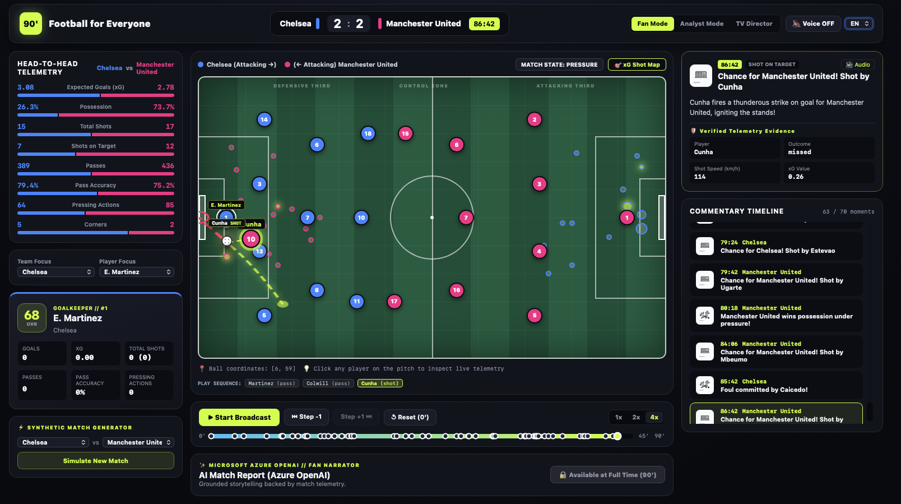

# Football for Everyone

Interactive match broadcast, on-pitch telemetry, and explainable AI commentary.



---

## About the Project

Football for Everyone is a web application that transforms raw football match telemetry (pitch coordinates, pressing actions, passing sequences, xG indices) into an intuitive, accessible experience for both fans and tactical analysts.

The application simulates matches phase by phase, renders a dynamic 2D tactical pitch, provides native audio commentary in three languages, and generates a post-match journalistic report at full time using Microsoft Azure OpenAI.

---

## Key Features

- **Interactive 2D Pitch**: Visualizes live player positions based on current phase and possession, passing arcs, shot trajectories to goal, and an xG shot map overlay. Clicking on any player opens their dossier (OVR rating, passes, shots, pressure events).
- **Multi-Perspective Commentary**: Automatically detects 13 key match events and tactical patterns (goals, penalties, tactical fouls, pressing windows, high turnovers, territorial control) with tailored modes:
  - *Fan Mode*: Dynamic, emotion-driven broadcast commentary.
  - *Analyst Mode*: Technical, metric-oriented reports (km/h shot speed, pressing volume, xG).
  - *TV Director*: Broadcast production view with on-air graphic overlays.
- **Multilingual Audio Commentary**: Native speech synthesis in English, Romanian, and Italian via the Web Speech API. Auto-play advances only after commentary completes. Smart auto-mute engages on faster speeds (2x, 4x) to avoid phonetic distortion.
- **Chronological Playback without Spoilers**: Step forward and backward through phases (`Step +1`, `Step -1`). The next-phase button is locked when you reach the latest played moment, preventing users from seeing future events before they happen.
- **Match Recap with Microsoft Azure OpenAI**: Unlocks strictly at full time (90'). The model receives validated match telemetry (final score, shot volume, possession, xG) to produce a grounded journalistic report without hallucinations. Includes a deterministic offline fallback engine if cloud services are unconfigured.
- **Synthetic Match Simulator**: Generate complete synthetic matches on demand between top European clubs (Arsenal, Liverpool, Chelsea, Real Madrid, Barcelona, etc.).

---

## Tech Stack

- **Backend**: Python 3.13, FastAPI, Uvicorn, Pydantic, python-dotenv.
- **AI & Cloud**: Microsoft Azure OpenAI Service (GPT models hosted on Azure AI Foundry).
- **Frontend**: React 19, Vite, Web Speech API, native SVG, and Modern CSS Grid.

---

## Getting Started

### 1. Backend (FastAPI)
From the project root:
```bash
python3 -m pip install -r requirements.txt
python3 -m uvicorn api.main:app --reload --port 8000
```
The API will be available at: `http://localhost:8000`

### 2. Frontend (React + Vite)
In a second terminal:
```bash
cd ui
npm install
npm run dev
```
The application will open at: `http://localhost:5173`

### 3. Automated Tests
To run backend unit tests:
```bash
python3 -m unittest discover tests
```
